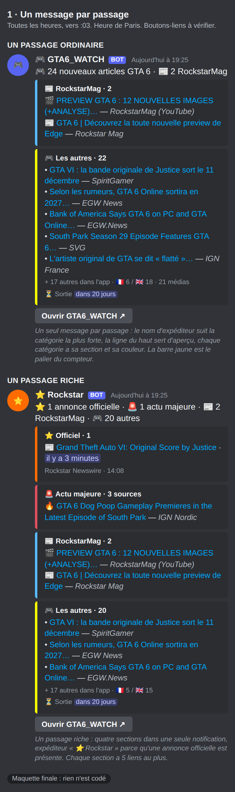
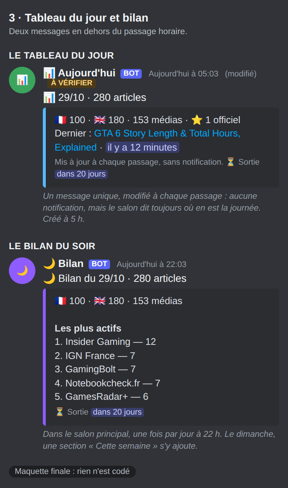

# Spec — la notification Discord « ultime » (à valider)

Statut : **proposition, rien n'est codé.** Écrite le 29/10/2026 avec Antoni, qui a tranché chaque
point par questions. Heures de Paris (UTC+1 depuis le 25/10). Tout touche le robot
(`discord_notify.py`, `feed_store.py`, `fetch_feeds.py`), **pas l'app** : le gel du code de l'app
ne s'applique pas.

Visuels, dans `tasks/visuels-discord/` :

| fichier | contenu |
|---|---|
| `ultime-1.png` | un passage ordinaire, un passage riche (quatre sections) |
| `ultime-2.png` | la nuit (annonce seule) et le matin à 5 h |
| `ultime-3.png` | le tableau du jour et le bilan du soir |
| `ultime-4.png` | après la sortie |
| `quand-1.png` à `quand-4.png` | quand chaque message arrive : une journée type, les situations, l'autour de la sortie |

## Ce qu'Antoni a décidé

| sujet | décision |
|---|---|
| **Un message par passage** | Officiels, actu majeure, RockstarMag et autres articles tiennent dans **un seul message à sections colorées** (jusqu'à 10 cartes par message ; on en utilise 4 au plus). Plus de carte RockstarMag séparée, plus de message officiel séparé. |
| Liens | **5 liens au plus par section, puis un compteur** « + N autres dans l'app » : jusqu'à 20 liens dans un message riche (confirmé). |
| Images | **Aucune**, ni grande image ni vignette. L'icône et le badge de l'app dans le push restent. |
| Expéditeur | **Un nom par catégorie, sans avatar** : « ⭐ Rockstar », « 🚨 », « 📰 RockstarMag », « 🎮 GTA6_WATCH » : la plus forte catégorie présente. |
| Aperçu | Une **ligne de texte en tête** du message (les décomptes), qui sert d'aperçu sur l'écran verrouillé. |
| Temps | **Temps relatif et compte à rebours vivants, seuls** : « publié il y a 3 minutes », « sortie dans 20 jours » (pas de « J-21 » à côté, confirmé). Discord les recalcule à l'affichage. |
| Jalons | **J-14, J-7, J-3, J-1 ; H-12 et H-1 ; « GTA VI est sorti » à minuit** : quelques messages rares (voir 10). |
| Bilan de la semaine | Une **section de plus dans le bilan du dimanche soir**, pas un message de plus. |
| Alerte de report | **Oui, sur les articles officiels seulement** (Rockstar, Take-Two) (voir 11). |
| Rythme | **Un message par heure**, comme aujourd'hui (environ 16 par jour de 6 h à 21 h). |
| Salon | **Un seul salon.** |
| Silence | **Rien n'est silencieux** : tout notifie normalement. |
| Boutons | Boutons-liens sous le message, **à vérifier** (je ne sais pas si un lien d'envoi sans bot peut en porter). **Vérification : trois messages marqués TEST dans ton salon principal**, déclenchés par toi (voir « Vérifier avant de coder »). |
| Tableau du jour | Un message **modifié en place** à chaque passage, sans notification, créé à 5 h. |
| Bilan du soir | 22 h, **avant et après la sortie**, **dans le salon principal** (le fil de forum est abandonné, décision du 29/10). Le dimanche, une section « Cette semaine ». |
| Actu majeure | **Inchangée** (rouge, pas de médias nommés) ; on **mesure d'abord les médias distincts**. |
| Officiels | Type de contenu, heure de publication ; **annonces d'abord, boutique ensuite** ; la boutique garde la catégorie « officiel » ; fusion EN/FR avec **titre en français** ; retard mesuré, relu après **10 alertes**. |
| RockstarMag | **Une section**, 🎬 pour les vidéos, extrait du résumé, silence la nuit, reste après la sortie, couleur de l'accent de l'app. |
| Push | Même vocabulaire que Discord quand il sera retenté. Il reste éteint. |
| Écarté | Fil de forum pour le bilan ; mention `@` qui sonne ; salons séparés ; regroupement des récapitulatifs ; message silencieux ; toute image ; rappel d'agenda ; plus de lignes ; passage plus fréquent sur les flux officiels. |

## État actuel, mesuré (29/10/2026)

- Un embed par passage, titre « 🎮 N nouveaux articles GTA 6 », 5 lignes (`APERCU_RECAP_MAX`),
  « + N autres dans l'app ». Les annonces officielles partent **à part**, une alerte par article
  (plafond `NOTIFS_OFFICIELLES_MAX` = 10). Les passages du jour comptaient 9 à 31 articles.
- Une ligne du récapitulatif : 200 caractères en médiane, 343 au maximum.
- 280 articles le 29/10 ; 116 par jour en moyenne du 22 au 28/10.
- Les messages arrivent vers **:03** (le robot finit à :03). Pause nocturne 00 h–05 h : rien ne part,
  sauf une annonce officielle.

## 1 · Anatomie d'un message

Un seul message à chaque passage où il y a quelque chose à dire :

1. **Nom d'expéditeur** (`username`), sans avatar : « ⭐ Rockstar » s'il y a une annonce officielle,
   sinon « 🚨 » pour une actu majeure, sinon « 📰 RockstarMag », sinon « 🎮 GTA6_WATCH ».
2. **Ligne d'aperçu** (`content`) : les décomptes, par exemple « 🎮 24 nouveaux articles GTA 6 ·
   📰 2 RockstarMag ». C'est le même texte que le titre du push (`feed_store.libelle_*`, écrit une
   seule fois). Si Discord affiche déjà ce texte autrement, on l'ajuste au premier envoi réel.
3. **Sections** (une carte chacune, sans titre en double) : ⭐ Officiel (orange) · 🚨 Actu majeure
   (rouge) · 📰 RockstarMag (accent de l'app) · 🎮 Les autres (couleur du palier du compteur : rose
   sous 24 h, orange sous 7 jours, jaune sous 30 jours, sinon bleu). Chaque section : **5 liens au
   plus** et « + N autres dans l'app ». Une section vide n'existe pas.
4. **Dernière section** : la ligne de détail en texte gris discret (🇫🇷 / 🇬🇧, médias) et
   « ⏳ Sortie dans 20 jours », avec une **balise de temps** Discord (`<t:1795042800:R>` = le
   19/11/2026 à 00:00 Paris, soit 23:00 UTC la veille) qui se recalcule seule. Après la sortie :
   « 🎮 Sorti il y a 2 jours », avec la même balise.
5. **Boutons-liens** « Ouvrir GTA6_WATCH » : **à vérifier**. Repli : le lien texte « Ouvrir GTA6_WATCH »
   déjà présent.

**Garde-fou de taille.** Discord limite l'ensemble des cartes d'un message à **6 000 caractères**.
Quatre sections de cinq lignes au pire (343 caractères) font 6 860 caractères : le robot coupe
d'abord dans « Les autres », puis dans RockstarMag, jamais dans une annonce officielle, jusqu'à
rester sous 5 800.

**Règles selon la situation**
- **La nuit (00 h–05 h)** : seule la section ⭐ Officiel part, seule dans son message. À **5 h**, le
  message réunit tout ce qui s'est accumulé (RockstarMag compris).
- **Après la sortie (19/11 00:00)** : le message ne part que s'il contient une annonce officielle, une
  actu majeure ou des articles RockstarMag ; la section « Les autres » n'en fait plus partie. Le pied
  devient « sorti il y a N jours ».
- **Rien n'est silencieux** : tout message notifie normalement.

## 2 · Le récapitulatif et ses sections

- **Les autres** compte les articles qui ne sont ni officiels, ni majeurs, ni RockstarMag. **Un article
  n'est donné qu'une fois** : il n'est plus listé dans « Les autres » s'il l'est dans sa section.
  Cela remplace le choix « le récapitulatif liste aussi RockstarMag », devenu sans objet.
- **Ligne de chiffres** : 🇫🇷 / 🇬🇧 et nombre de médias en texte gris. Le message du matin additionne la
  nuit : il n'affiche que la répartition FR/EN (la langue se garde dans les comptes mis de côté),
  pas un nombre de médias qui ne serait plus un compte de distincts.

## 3 · L'actu majeure : une mesure d'abord (faite le 29/10/2026, lot 1)

Les « sources » du seuil comptent des **flux**, pas des médias. Trois mesures, de la plus grossière à la
meilleure, sur les **93 articles à 3 flux ou plus** (sur 3 300) :

| ce qu'on compte | articles qui en ont au moins 3 |
|---|---|
| noms de flux hors « Google News » | 3 sur 93 |
| + le suffixe du titre (« … - IGN Nordic ») | 9 sur 93 |
| **sites distincts des liens** (le robot décode les liens Google News jusqu'à l'éditeur) | **39 sur 93, 49 au mieux** |

Par sites : 30 articles n'en ont qu'un, 24 deux, 29 trois, 9 quatre, 1 six ; 15 ont un lien resté sur Google
News (d'où l'écart de 10 entre 39 et 49). Le seuil de trois flux laisse donc passer **44 à 54 articles sur 93
qui ne reposent pas sur trois sites**. Limite : un site qui n'est pas une rédaction (une page de jeu, un
annonceur) compte quand même, et deux éditions régionales d'un média (sea.ign.com, pk.ign.com) sont
ramenées à un seul site.

`python3 mesure_actu_majeure.py` rejoue la mesure (lecture seule) et le robot écrit une ligne `[majeur]` par
actu majeure à chaque passage, sans titre ni lien. **Aucun changement du message** tant qu'Antoni n'a pas
tranché : garder trois flux, ou compter les sites.

## 4 · Les annonces officielles (une section)

Mesuré : 85 officiels sur 3 300 articles, 24 jours concernés (10 avec une seule alerte, au plus 5 hors
rafale), 6 flux officiels sur 70. 3 seulement ont un résumé. Le dernier, « Original Score by Justice »,
est arrivé par **Google News (EN)** : l'alerte actuelle l'affiche comme source alors que son lien est
sur rockstargames.com.

- **O2 · Le vrai type**, tiré du **domaine du lien** (comme `statut_officiel`), jamais du nom du flux :
  rockstargames.com → 📰 Newswire (42), youtube.com → 🎬 Vidéo (5), support.rockstargames.com → 🛠
  Assistance (5), ir.take2games.com → 📈 Investisseurs Take-Two (1), store.rockstargames.com → 🛍 Boutique
  (32), autre domaine officiel → ⭐.
- **O3 · Heure de publication** : « il y a 3 minutes » (balise de temps) et l'heure exacte en gris.
- **O4 · Mesurer le retard réel (fait au lot 1, à relire).** Le robot passe toutes les heures : une annonce
  peut arriver jusqu'à une heure après sa publication, plus 1 min 30 à 3 min de traitement, **non mesuré**.
  Le robot écrit désormais une ligne par annonce : `[officiel] retard : N min (publication hh:mm, envoi
  hh:mm)`, sans titre ni lien. Sont rangés à part et **non comptés** : une date « première vue » (posée par le
  robot, avec des microsecondes) et une date dans le futur ; les articles arrivés par Google News sont
  **calculés mais étiquetés « via agrégateur »**. **On relit après 10 alertes**, et seulement alors on
  parle d'un second déclencheur plus fréquent.
- **O5 · Fusion EN/FR.** Mesuré : 30 officiels portent un identifiant d'article du Newswire, pour 14
  identifiants distincts ; **10 de ces 14 existent en anglais et en français**. Deux articles du même
  passage au **même identifiant** n'occupent qu'**une ligne**, **titre en français**, avec les deux
  liens. Les 55 autres officiels n'ont pas d'identifiant et ne fusionnent jamais.
- **O6 · 5 liens au plus, puis un compteur.** Le 08/10 (32 officiels, dont 28 produits de boutique) : une
  section de 5 liens et « + 27 autres annonces officielles ». **Ordre : les annonces non-boutique
  d'abord, puis la boutique, chacune par date** : par date décroissante, les 4 vraies annonces auraient
  été aux rangs 27 à 32, toutes cachées. **La boutique garde la catégorie « officiel ».**
  `NOTIFS_OFFICIELLES_MAX` (aujourd'hui 10 alertes) devient le nombre de liens de la section ; il est
  **partagé avec le push** (`push_notify.py`, ligne 478), sans effet tant qu'il est éteint. Le README et
  un test citent ce plafond.

## 5 · RockstarMag (une section)

Mesuré : **130 articles sur 3 300** (3,9 %), sur 54 jours, **médiane 2 par jour, au plus 14** ; en
octobre 18 jours sur 29, 4 le 29/10. 57 sont des vidéos YouTube (44 %), 43 viennent du flux du site, 30
de Google News FR. 100 sur 130 ont un résumé (493 caractères en médiane), mais **3 des 4 articles du
29/10, arrivés par Google News, n'en ont pas** : l'extrait ne sera pas toujours là. 14 sont publiés
entre minuit et 4 h. Ils sont déjà protégés de l'effacement de l'historique (`item_protege`).

- Section « 📰 RockstarMag · N », **5 liens au plus**, 📰 (site) ou **🎬 (vidéo, domaine youtube.com)**, et un
  **extrait de 160 caractères** du premier article qui en a un (nettoyé par `nettoie_resume`), rien sinon.
- **Couleur** : l'accent de l'app (`--accent`, `#58b9ff`), car l'onglet RockstarMag n'a pas de couleur
  propre ; presque identique au bleu du récapitulatif (`#5493FF`), à juger sur le visuel.
- **Repère des envois** : les articles RockstarMag de `feed.json` des 48 dernières heures **dont le lien
  n'a pas déjà été envoyé**, avec les 50 derniers liens envoyés (`rockstarmag_envoyes`). La date de
  publication n'est pas le repère : un article publié à 11 h et trouvé à 13 h serait perdu. Une relance
  à la main ne renvoie rien ; un article qui arrive deux fois est comparé après `canonical_link`.
- **La nuit** : aucune exception à la pause ; à 5 h, la section réunit la nuit. **Après la sortie** : elle
  reste.

## 6 · Le tableau du jour (modifié en place)

Un message « 📊 29/10 · N articles » créé au premier passage de 5 h, puis **modifié** à chaque passage :
total du jour, 🇫🇷 / 🇬🇧, médias, nombre d'officiels, dernier article avec « il y a N minutes », compte à
rebours. **Une modification ne notifie pas** ; sa création le fait une fois par jour.

- État dans `feed.json` : l'identifiant du message et le jour (`tableau_id`, `tableau_jour`). Il n'a rien
  de secret (le secret est le jeton du lien d'envoi). Il faut envoyer avec `?wait=true` pour recevoir cet
  identifiant.
- Si la modification échoue (message supprimé), le robot en crée un nouveau.
- **À vérifier au premier envoi réel** : que Discord accepte la modification par ce lien d'envoi.

## 7 · Le bilan du soir

Au **premier passage dont l'heure de Paris est 22 h ou plus**, un message par jour civil : total, FR/EN,
médias distincts, cinq médias les plus actifs (comptés sur le **média du titre**, pas sur le nom du flux :
« Google News (EN) — 124 » n'apprend rien) et les trois sujets les plus couverts. Exemple réel à 19 h 25 :
280 articles, 153 médias, Insider Gaming 12, IGN France 7, GamingBolt 7, Notebookcheck.fr 7, GamesRadar+ 6.

**Le dimanche**, le message gagne une section « 📅 Cette semaine » (total de la semaine, sujets les plus couverts, nombre d'annonces officielles) : pas de message de plus.

`bilan_envoye_le` dans `feed.json` interdit un second envoi (une relance à 22 h 30 ne le renvoie pas).
Il tient avant la pause nocturne et **continue après la sortie**. Il est publié dans le **salon principal** : le fil de forum est abandonné (décision d'Antoni).

## 10 · Les jalons du compte à rebours

Quelques messages rares, un par jalon, chacun **envoyé une fois** (`jalons_envoyes` dans `feed.json`),
au **premier passage à ou après l'heure cible**, heure de Paris :

| jalon | cible | message |
|---|---|---|
| J-14, J-7, J-3, J-1 | 09 h le 05/11, 12/11, 16/11, 18/11 (jours civils) | « ⏳ J-7 · sortie dans 7 jours » |
| H-12 | 12 h le 18/11 | « ⏳ H-12 » |
| H-1 | 23 h le 18/11 | « ⏳ H-1 » |
| sortie | 00 h le 19/11 | « 🎉 GTA VI est sorti » |

Chaque jalon dit le décompte (balise de temps vivante) et ce qui s'est passé depuis le jalon précédent :
nombre d'articles, annonces officielles, trois sujets les plus couverts. Le robot passe à :03 : un jalon
arrive donc quelques minutes après l'heure cible (« GTA VI est sorti » vers 00 h 03, la pause nocturne
étant levée cette nuit-là). **Un jalon manqué de plus de 90 minutes n'est pas envoyé** (un « H-1 » à 23 h 50
ne veut plus rien dire), sauf « sorti », toujours envoyé. Le bilan du soir de ces jours continue.

## 11 · L'alerte de report, sur les officiels seulement

Un report de la sortie serait la nouvelle la plus importante. Mesuré : sur 3 300 titres, **39 contiennent
un mot de report ou de retard**, presque tous en octobre, et ce sont en majorité des démentis (« Has GTA 6
been delayed again? No… ») ou d'autres jeux. **Aucun n'est un article officiel.** Une alerte sur tout le
fil aurait donc surtout de faux positifs.

- **Périmètre** : les articles marqués officiels (Rockstar, Take-Two). Motifs : *delay, delayed, delays,
  postpone(d), pushed back, new release date, nouvelle date de sortie, reporté(e) de/à, repoussé(e)*. Le mot
  anglais « report(s) » est **exclu** : il veut aussi dire « publie » (« reports results »).
- Mesure du motif restreint : **0 article officiel sur 85** ; 37 titres du fil entier (le bruit qu'on évite).
- **Message** : section rouge « 🚨 Report possible · officiel » avec le lien, expéditeur « 🚨 Report possible »,
  prioritaire sur toute autre catégorie ; il part aussi la nuit, comme une annonce officielle.
- **Limite** : on ne lit que le titre et le résumé. Un report annoncé dans le corps d'un communiqué
  (résultats de Take-Two le 09/11, par exemple) ne serait pas vu : l'annonce officielle partirait comme
  d'habitude, sans cette alerte. À mesurer : les formulations réelles d'un report officiel passé.

## 8 · Un vocabulaire commun (Discord, push, app)

La même grammaire partout, un titre écrit **une seule fois** (`feed_store.libelle_*`) et repris mot pour
mot par Discord et par le push. Ordre d'importance : **officiel > actu majeure > RockstarMag >
récapitulatif > bilan**.

| catégorie | marqueur | couleur | titre |
|---|---|---|---|
| Annonce officielle | ⭐ | orange `#FF6B00` | « ⭐ N annonce(s) officielle(s) Rockstar » |
| Actu majeure | 🚨 (🔥 sur la ligne) | rouge `#E04F5F` | « 🚨 Actu majeure — N sources sur le même sujet » |
| RockstarMag | 📰 site, 🎬 vidéo | accent de l'app `#58b9ff` | « 📰 RockstarMag — N nouveau(x) » |
| Récapitulatif | 🎮 | palier du compteur | « 🎮 N nouveaux articles GTA 6 » |
| Tableau du jour | 📊 | vert | « 📊 JJ/MM · N articles » |
| Bilan du soir | 🌙 | violet `#8e5cff` | « 🌙 Bilan du JJ/MM : N articles » |
| État des sources | ⚠️ / ✅ | rouge / vert | « ⚠️ État des sources » |
| Push mort | 🔕 | orange `#E67E22` | existant |

Le push reprendra ce tableau quand il sera retenté : même titre, même marqueur, et l'ordre d'importance
pour choisir l'article cité dans son corps (`article_le_plus_notable` suit déjà : officiel, puis nombre de
rédactions, puis date). Aujourd'hui seuls le récapitulatif et l'annonce officielle y sont alignés.

## 9 · Quand chaque message arrive

Les quatre images `quand-*.png` montrent une journée type (articles par heure), les situations et
l'autour de la sortie : pause nocturne levée du 18 au 20/11 inclus, message du passage silencieux après le
19/11 00:00 sauf annonce officielle, actu majeure ou RockstarMag, bilan du soir qui continue.

## Vérifier avant de coder

Trois points sont à vérifier avec le vrai lien d'envoi : les **boutons-liens**, la **modification d'un
message** et la **balise de temps relatif**. Décision d'Antoni : **directement dans le salon principal,
trois messages marqués « TEST »**, déclenchés par lui. Un workflow à part (`test-discord.yml`,
`workflow_dispatch`, `contents: read`, comme `test-push.yml`) envoie : (1) un message avec deux
boutons-liens ; (2) un message puis sa modification ; (3) un message avec la balise de sortie. Il
écrit dans le journal public **ce que Discord a répondu**, jamais le lien d'envoi. **Rien n'est envoyé
sans son « go ».** Le résultat décide du repli (lien texte, nouveau message).

## Risques et ce que je ne sais pas

- **Boutons-liens** : à vérifier ; repli sur le lien texte.
- **Un compte à rebours qui dit « dans 20 jours » alors que l'app dit « J-21 »** : Discord compte une durée
  (20 j 4 h), l'app des jours civils. Les deux sont justes et ne coïncident pas ; choix d'Antoni : le
  compte vivant seul. Les jalons J-14 à J-1 sont, eux, en jours civils, comme l'app.
- **Modification en place** : je connais cette fonction de Discord mais ne l'ai pas vue marcher avec ce lien d'envoi : un envoi de test la confirmera, avec un repli prévu (un nouveau message).
- **La ligne d'aperçu** : si Discord affiche déjà le titre de la première carte, elle sera redondante.
- **6 000 caractères** : voir le garde-fou. **Douze messages au maximum** de Discord par minute pour un lien
  d'envoi : sans objet à notre rythme.
- **Exceptions à « un seul message par passage »** : désormais seulement les alertes de source, le tableau
  du jour (création), le bilan du soir et le « push mort ».
- Les maquettes sont des dessins : Discord sur téléphone peut rendre un peu différemment.

## Ordre de réalisation proposé

Un lot par PR, chacun avec ses contrôles et sa preuve d'échec, après ton « go » :
1. **Mesures sans effet visible** : retard des officiels (O4) et médias distincts de l'actu majeure (3). Elles
   demandent du temps, donc d'abord.
2. **Le message à sections** : expéditeur, ligne d'aperçu, sections, 5 liens, garde-fou de taille, pied et
   temps relatifs, règles de nuit et d'après-sortie.
3. **Le détail des officiels** : type, heure, ordre, fusion EN/FR, plafond.
4. **La section RockstarMag** : extrait, 🎬, repère des liens envoyés.
5. **Le tableau du jour**, puis **le bilan du soir**.
6. **Le workflow de vérification (TEST)**, avant le tableau du jour et les boutons.
7. **Les jalons** (10) et **l'alerte de report** (11) : peu de code, peu de volume ; à prévoir **avant le 05/11** (J-14).
8. **Les boutons-liens**, une fois vérifiés.

## Contrôles prévus (chacun prouvé capable d'échouer contre l'ancien code)

- Message : un seul message par passage ; expéditeur selon la plus forte catégorie ; ligne d'aperçu égale
  au titre du push ; une section vide n'existe pas ; 5 liens au plus par section et compteur exact (0, 1,
  5, 6, 11, 32) ; un article n'apparaît que dans une section ; **les cartes d'un message restent sous 6 000
  caractères** avec quatre sections de lignes de 343 caractères ; la coupe n'enlève jamais une annonce
  officielle ; la ligne d'aperçu ne dépasse pas 2 000 caractères.
- Temps : la balise de sortie est `<t:1795042800:R>` avant le 19/11 00:00 Paris et le pied dit « sorti » après ;
  le palier de couleur suit `palierCompteur`, **lu dans `docs/index.html`** par le test, des deux côtés de
  chaque seuil et au changement d'heure.
- Nuit : de 0 h à 5 h seule la section ⭐ part ; à 5 h tout part ; une relance à la main à 3 h n'envoie que
  les officiels.
- Officiels : libellé du domaine du lien, jamais du nom du flux ; domaine inconnu → libellé générique ;
  annonces avant boutique ; même identifiant d'article dans le même passage → une ligne avec deux liens,
  identifiants différents → jamais fusionnés ; la ligne de retard n'écrit ni titre ni lien.
- RockstarMag : une section par passage où un article est entré, jamais de nuit ; un seul envoi même
  relancé ; un article trouvé en retard est quand même envoyé ; 🎬 seulement pour youtube.com ; extrait
  absent quand aucun n'en a ; cinq liens et compteur exact.
- Tableau : un seul par jour civil à Paris ; une modification ne crée pas de message ; modification
  échouée → création d'un nouveau ; l'identifiant retenu n'est jamais un jeton.
- Bilan : un seul par jour civil à Paris, même avec deux passages après 22 h ; aucun avant 22 h ; heures
  testées des deux côtés du changement d'heure.
- Jalons : chaque jalon une seule fois, même relancé ; heure de Paris et passage à l'heure d'hiver ; jalon manqué de plus de 90 minutes non envoyé, sauf « sorti » ; « sorti » envoyé même tard.
- Report : un titre officiel avec un motif part en 🚨 ; le même titre non officiel ne déclenche rien ; « reports results » ne déclenche rien ; part aussi la nuit.
- Dans tous les cas : aucun secret ni URL de webhook dans un journal ; `DISCORD_WEBHOOK_URL` reste dans les secrets GitHub ; aucun nom de modèle.
