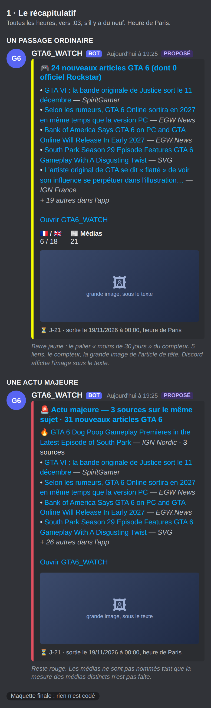
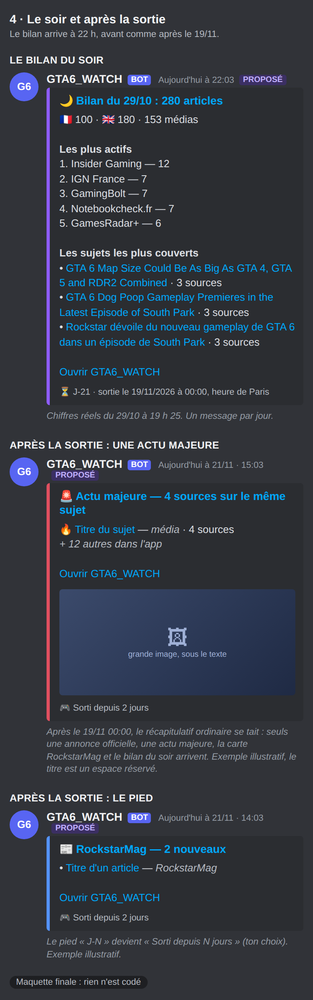
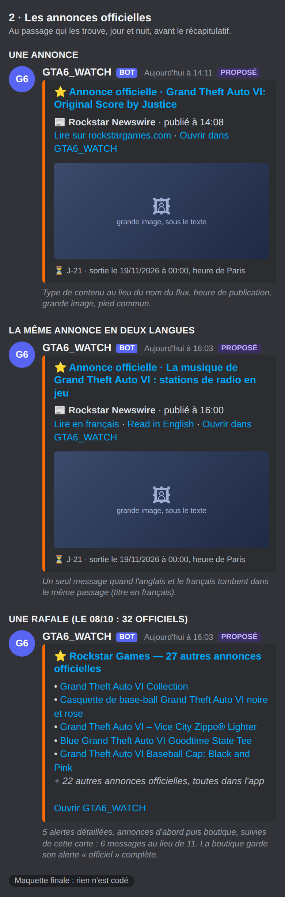
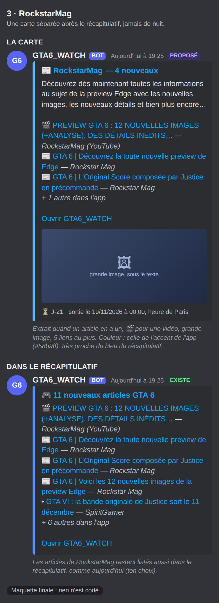
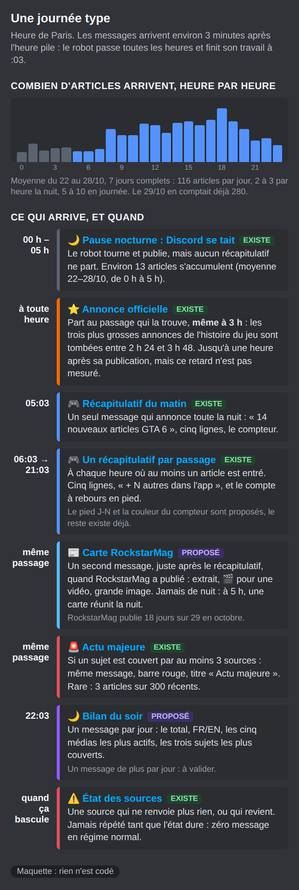

# Spec — la notification Discord (version finale, à valider)

Statut : **proposition, rien n'est codé.** Écrite le 29/10/2026 avec Antoni, qui a tranché
chaque point par questions. Heures de Paris (UTC+1 depuis le 25/10). Tout touche le robot
(`discord_notify.py`, `feed_store.py`, `fetch_feeds.py`), **pas l'app** : le gel du code de
l'app ne s'applique pas.

Visuels, dans `tasks/visuels-discord/` :

| fichier | contenu |
|---|---|
| `final-1.png` | le récapitulatif, passage ordinaire et actu majeure |
| `final-2.png` | les annonces officielles : une annonce, deux langues, une rafale |
| `final-3.png` | RockstarMag : la carte, et le récapitulatif qui les liste aussi |
| `final-4.png` | le bilan du soir et l'après-sortie |
| `quand-1.png` à `quand-4.png` | quand chaque message arrive : une journée type, les situations, l'autour de la sortie |

## Ce qu'Antoni a décidé

| sujet | décision |
|---|---|
| Images | **Une grande image partout** : récapitulatif, annonces officielles, carte RockstarMag. Aucun filtre de spoilers. Discord n'en accepte qu'une par carte et l'affiche **sous le texte**, pas au-dessus (à vérifier en vrai, voir Risques). |
| Récapitulatif | Reste à **5 lignes puis un compteur**. L'idée « plus de lignes » est retirée. |
| Compte à rebours | Pied « ⏳ J-N · sortie le 19/11/2026 à 00:00 », couleur de barre du palier du compteur. **Après la sortie : « Sorti depuis N jours ».** |
| Ligne de chiffres | 🇫🇷 / 🇬🇧 et nombre de médias. |
| Actu majeure | **Inchangée** : rouge, pas de médias nommés. On **mesure d'abord les médias distincts** (voir 2). |
| Bilan du soir | Un message par jour à 22 h, **avant et après la sortie**. |
| Annonces officielles | Grande image, type de contenu, heure de publication, pied commun ; **5 alertes détaillées puis une carte de 5 liens et un compteur** ; **annonces d'abord, boutique ensuite** ; **la boutique garde son alerte « officiel » complète** ; fusion EN/FR avec **titre en français** ; mesure du retard, relue après **10 alertes**. |
| RockstarMag | **Carte séparée**, 🎬 pour les vidéos, extrait du résumé, **silence la nuit**, **reste après la sortie**, couleur de **l'accent de l'app**. Le récapitulatif **liste aussi** ses articles. |
| Écarté | Mention `@` qui sonne ; passage plus fréquent sur les flux officiels ; vignette filtrée ; rappel d'agenda ; plus de lignes. |

## État actuel, mesuré (29/10/2026)

- Un embed par passage, titre « 🎮 N nouveaux articles GTA 6 », 5 lignes (`APERCU_RECAP_MAX`),
  « + N autres dans l'app ». Les passages du jour comptaient 9 à 31 articles.
- Une ligne du récapitulatif : 200 caractères en médiane, 343 au maximum ; les 10 plus
  longues font 3 195 caractères, sous les 3 900 gardés pour la description.
- 3 300 articles dans le fil : **87 %** des 300 plus récents ont une image, toutes en https
  (la plus longue URL fait 263 caractères, Discord en accepte 2 048) ; 280 articles le 29/10.
- Les messages arrivent vers **:03** (le robot finit à :03). Pause nocturne 00 h–05 h :
  rien ne part, sauf une annonce officielle.

## 1 · Le récapitulatif

1. **Grande image** : celle de l'article de tête (l'ordre existant : un officiel d'abord,
   sinon le plus récent). Il faut garder `image` dans l'aperçu (septième champ ;
   `apercu_de` en garde six, pour le coût dans `feed.json` pendant la pause nocturne : une
   URL de 263 caractères au plus sur cinq aperçus est négligeable, à mesurer avant de
   livrer). Sans image valide (https, 2 048 caractères au plus) : rien, le message part
   comme aujourd'hui.
2. **Pied et couleur.** Pied « ⏳ J-N · sortie le 19/11/2026 à 00:00, heure de Paris », N en
   **jours civils à Paris** (même règle que l'agenda). Barre : moins de 24 h rose `#ff2fa8`,
   moins de 7 jours orange `#ff8a00`, moins de 30 jours jaune `#f7ff00`, sinon bleu
   `#5493FF` ; les seuils sont ceux de `palierCompteur` dans l'app, recopiés côté robot avec
   un test qui **les lit dans `docs/index.html`**. L'actu majeure garde son rouge. Après la
   sortie : « 🎮 Sorti depuis N jours » et la barre repasse au bleu.
3. **Ligne de chiffres** : champs « 🇫🇷 / 🇬🇧 » et « 📰 Médias », sur les articles du passage. Le
   récapitulatif du matin additionne la nuit : il n'affiche que la répartition FR/EN (la langue
   se garde dans les comptes mis de côté), pas un nombre de médias qui ne serait plus un compte
   de distincts.

## 2 · L'actu majeure : une mesure d'abord

Mesuré : sur **93 articles à 3 sources ou plus, 90 en ont moins de trois hors « Google News »**
(0 : 20, 1 : 48, 2 : 22, 3 : 3). Les « sources » comptent des **flux**, pas des médias, et deux
flux Google News du même sujet suffisent. Je ne sais pas combien de médias distincts cela
représente : le vrai média d'un article Google News est dans le suffixe de son titre.

Aucun changement du message tant que ce n'est pas mesuré. **Mesure** : un script, hors
production, qui compte les médias distincts de chaque actu majeure (suffixe du titre et flux
qui ne s'appellent pas « Google News »), puis une décision d'Antoni sur le seuil de 3.

## 3 · Le bilan du soir

Au **premier passage dont l'heure de Paris est 22 h ou plus**, un message par jour civil :
total, FR/EN, médias distincts, cinq médias les plus actifs (comptés sur le **média du titre**,
pas sur le nom du flux : « Google News (EN) — 124 » n'apprend rien) et les trois sujets les
plus couverts. Exemple réel à 19 h 25 : 280 articles, 153 médias, Insider Gaming 12, IGN France
7, GamingBolt 7, Notebookcheck.fr 7, GamesRadar+ 6.

L'état `bilan_envoye_le` dans `feed.json` interdit un second envoi (une relance à la main à
22 h 30 ne le renvoie pas). Il tient avant la pause nocturne (22 h < minuit) et **continue
après la sortie** : c'est un résumé, il n'a pas le défaut du récapitulatif horaire. C'est une
exception de plus à « un seul message par passage ».

## 4 · Les annonces officielles

État actuel : un embed orange par article, « ⭐ Rockstar Games — officiel · <titre> », une ligne
qui porte le **nom du flux**, un lien vers l'app ; plafond de 10 alertes détaillées
(`NOTIFS_OFFICIELLES_MAX`), puis une carte qui liste les suivantes. Mesuré : 85 officiels sur
3 300 articles, 24 jours concernés (10 avec une seule alerte, au plus 5 hors rafale), 6 flux
officiels sur 70. 77 officiels sur 85 ont une image (91 %), 3 seulement un résumé. Le dernier,
« Original Score by Justice », est arrivé par **Google News (EN)** : l'alerte l'affiche comme
source alors que son lien est sur rockstargames.com.

- **O1 · Grande image** de l'annonce (pas pour la carte groupée). Mêmes règles de validité.
- **O2 · Le vrai type**, tiré du **domaine du lien** (comme `statut_officiel`), jamais du nom du
  flux : rockstargames.com → 📰 Rockstar Newswire (42 articles), youtube.com → 🎬 Vidéo Rockstar
  (5), support.rockstargames.com → 🛠 Assistance Rockstar (5), ir.take2games.com → 📈
  Investisseurs Take-Two (1), store.rockstargames.com → 🛍 Boutique Rockstar (32), autre domaine
  officiel → ⭐ Rockstar Games.
- **O3 · Heure de publication** (`timestamp` de l'embed, affiché à l'heure de l'appareil) et pied
  commun « ⏳ J-N » (puis « Sorti depuis N jours »).
- **O4 · Mesurer le retard réel.** Le robot passe toutes les heures : une annonce peut arriver
  jusqu'à une heure après sa publication, plus 1 min 30 à 3 min de traitement, **non mesuré**.
  Une ligne de journal par alerte : « retard : N min (publication hh:mm, envoi hh:mm) », sans
  titre ni lien ; les articles arrivés par Google News ou sans date de publication se comptent à
  part, sans retard calculé. **On relit après 10 alertes**, et seulement alors on parle d'un
  second déclencheur plus fréquent.
- **O5 · Fusion EN/FR.** Mesuré : 30 officiels portent un identifiant d'article du Newswire
  (`/article/<identifiant>/`), pour 14 identifiants distincts ; **10 de ces 14 existent en anglais
  et en français**. Deux alertes du même passage au **même identifiant** deviennent un seul
  embed, **titre en français**, avec les deux liens. Les 55 officiels sans identifiant (boutique,
  vidéos, pages) ne fusionnent jamais. Une alerte déjà partie ne se rattrape pas si l'autre
  langue arrive à un passage suivant.
- **O6 · 5 alertes détaillées, puis une carte de 5 liens et un compteur.** Le 08/10 (32 officiels,
  dont 28 produits de boutique) : 5 + 5 liens + 22 = 32, soit **6 messages au lieu de 11**. Le
  plafond est partagé avec le push (`push_notify.py`, ligne 478) : le passer à 5 le change aussi
  pour lui, ce qui est sans effet tant qu'il est désactivé. Le README et un test citent ce
  plafond. **Ordre : les annonces non-boutique d'abord, puis la boutique, chacune par date** :
  par date décroissante, les 4 vraies annonces du 08/10 auraient été aux rangs 27 à 32, toutes
  cachées dans le compteur. **La boutique garde son alerte « officiel » complète.**

## 5 · RockstarMag

Mesuré : **130 articles sur 3 300** (3,9 %), sur 54 jours, **médiane 2 par jour, au plus 14**. En
octobre : 18 jours sur 29, et 4 le 29/10. 57 sont des vidéos YouTube (44 %), 43 viennent du flux
du site, 30 de Google News FR. **130 sur 130 ont une image** ; 100 sur 130 un résumé (493
caractères en médiane), mais **3 des 4 articles du 29/10, arrivés par Google News, n'en ont
pas**. 14 sont publiés entre minuit et 4 h. Ils sont déjà protégés de l'effacement de
l'historique (`item_protege`).

- **Une carte séparée** après le récapitulatif, « 📰 RockstarMag — N nouveau(x) », **5 liens au plus**
  et « + N autres dans l'app », 📰 (site) ou **🎬 (vidéo, domaine youtube.com)**, **grande image** du
  premier article, **extrait de 160 caractères** du premier article qui en a un (nettoyé par
  `nettoie_resume`), rien sinon, même pied « ⏳ J-N ».
- **Couleur** : celle de **l'accent de l'app** (`--accent`, `#58b9ff`), car l'onglet RockstarMag n'a
  pas de couleur propre. Elle est **presque identique au bleu du récapitulatif** (`#5493FF`) ; à
  juger sur le visuel.
- **Repère des envois** : les articles RockstarMag de `feed.json` des 48 dernières heures
  **dont le lien n'a pas déjà été envoyé**, avec les 50 derniers liens envoyés
  (`rockstarmag_envoyes`). La date de publication n'est pas le repère : un article publié à
  11 h et trouvé à 13 h serait perdu. Une relance à la main ne renvoie rien ; un article qui
  arrive deux fois (site, puis Google News) est comparé après `canonical_link`.
- **La nuit** : aucune exception à la pause. À 5 h, une carte réunit ce qui a été publié.
- **Après la sortie** : la carte reste.
- Le récapitulatif **continue de lister** ses articles, comme aujourd'hui.

Coût : un message de plus les jours où RockstarMag publie, troisième exception à « un seul
message par passage » après les alertes de source et les annonces officielles.

## 6 · Quand chaque message arrive

Les quatre images `quand-*.png` montrent une journée type (articles par heure), les situations
et l'autour de la sortie : pause nocturne levée du 18 au 20/11 inclus, récapitulatif horaire
silencieux après le 19/11 00:00 sauf annonce officielle ou actu majeure, bilan du soir et carte
RockstarMag qui continuent.

## Risques et ce que je ne sais pas

- **L'image sous le texte.** Dans un embed, Discord affiche la grande image sous la description,
  pas au-dessus du titre. C'est ma connaissance de Discord, pas une mesure : à vérifier avec un
  premier envoi réel avant de généraliser.
- **Aucun filtre de spoilers** (choix d'Antoni) : une image de fuite s'afficherait en grand. Le
  mode « sans spoiler » de l'app, lui, floute ; le robot ne le fait pas.
- **L'image d'un site tiers peut ne pas s'afficher** (lien direct refusé) : le message reste
  intact, sans image.
- **Discord limite un embed à 6 000 caractères** : cinq lignes de 343 caractères, des champs et un
  pied tiennent largement.
- **Trois exceptions à « un seul message par passage »** (sources, officiels, RockstarMag) plus
  le bilan du soir quotidien.
- Les maquettes sont des dessins : Discord sur téléphone peut rendre un peu différemment, et les
  images y sont des espaces réservés.

## Ordre de réalisation proposé

Un lot par PR, chacun avec ses contrôles et sa preuve d'échec, après ton « go » :
1. **Mesures sans effet visible** : retard des officiels (O4) et médias distincts de l'actu majeure
   (2). Elles demandent du temps pour s'accumuler, donc d'abord.
2. **Pied, couleur et « Sorti depuis N jours »** (récapitulatif, officiels, RockstarMag).
3. **Annonces officielles** : type, heure, grande image, plafond de 5, ordre, fusion EN/FR.
4. **Grande image du récapitulatif** et ligne de chiffres.
5. **Carte RockstarMag.**
6. **Bilan du soir.**

## Contrôles prévus (chacun prouvé capable d'échouer contre l'ancien code)

- Image : https et 2 048 caractères au plus, sinon rien ; celle de l'article de tête.
- Pied : seuils lus dans `docs/index.html`, de chaque côté, à minuit Paris et au changement
  d'heure ; rouge conservé pour l'actu majeure ; « Sorti depuis N jours » après le 19/11 00:00.
- Chiffres : langue comptée, y compris à travers la pause nocturne ; pas de nombre de médias le
  matin.
- Officiels : libellé du domaine du lien, jamais du nom du flux ; domaine inconnu → libellé
  générique ; 5 alertes puis une carte de 5 liens et le compteur exact (0, 5, 6, 11 et 32
  officiels) ; annonces avant boutique ; même identifiant d'article dans le même passage → un
  seul message, identifiants différents → jamais fusionnés ; la ligne de retard n'écrit ni titre,
  ni lien, ni image.
- RockstarMag : une carte par passage où un article est entré, jamais de nuit ; un seul envoi même
  relancé ; un article trouvé en retard est quand même envoyé ; 🎬 seulement pour youtube.com ;
  extrait absent quand aucun n'en a ; cinq liens et compteur exact ; le récapitulatif continue de
  les lister.
- Bilan : un seul par jour civil à Paris, même avec deux passages après 22 h ; aucun avant 22 h ;
  heures testées des deux côtés du changement d'heure.
- Dans tous les cas : aucun secret ni URL de webhook dans un journal ; `DISCORD_WEBHOOK_URL` reste
  dans les secrets GitHub ; aucun nom de modèle.
