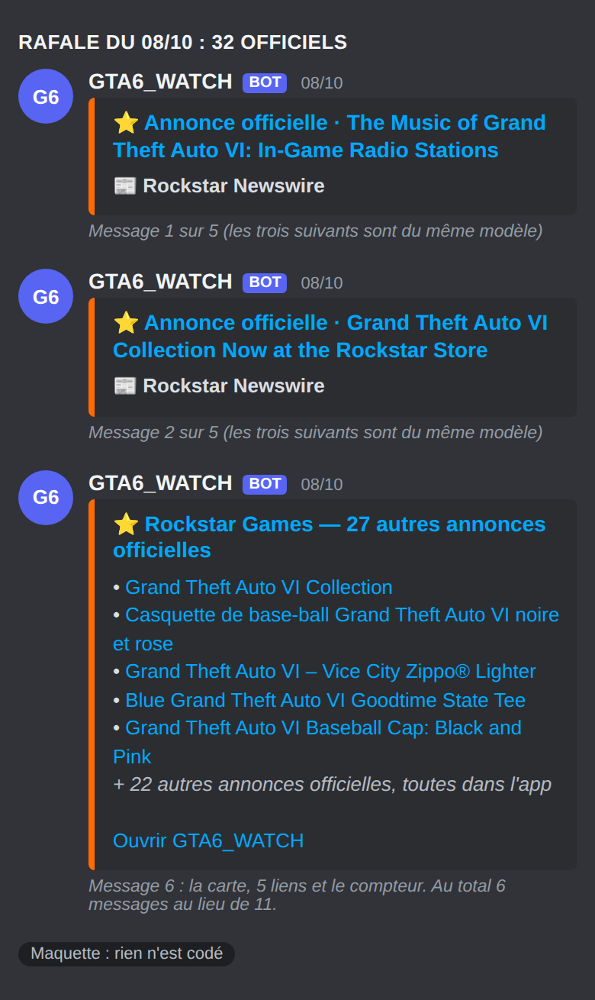
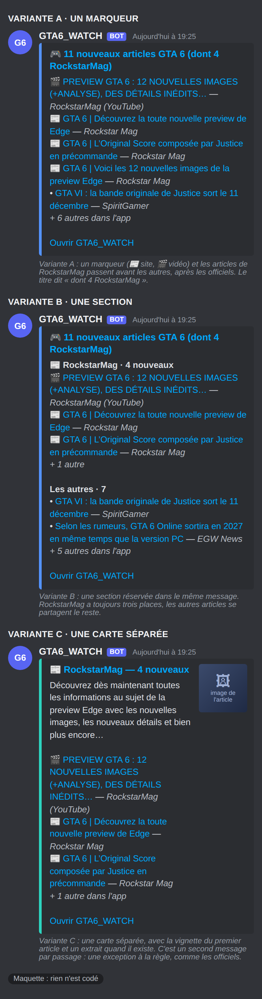

# Spec — la notification Discord : six améliorations

Statut : **proposition, rien n'est codé.** Écrite le 29/10/2026 à la demande
d'Antoni (« Améliorer la notification Discord, propose 7 idées, ne code pas »), puis
réduite à son choix : **1, 2, 3, 5 et 7** (l'idée 6, le rappel d'agenda, est écartée ;
l'idée 4, plus de lignes, a été retirée le même jour). Visuel final : `tasks/spec-discord-notification-final.png`.
La section « Les annonces officielles » (plus bas) a été ajoutée le même jour, après
son choix : grande image, vrai type, heure et pied, mesure du retard, fusion EN/FR.
La section « RockstarMag » suit : une carte séparée, avec 🎬 pour les vidéos, un extrait,
silence la nuit.
Heures de Paris (UTC+1 depuis le 25/10).

Tout ce qui suit touche `discord_notify.py`, `feed_store.py` et le robot, **pas
l'app** (`docs/`) : le gel de l'app ne s'applique pas. Le chiffre « J-21 » et les
couleurs reprennent pourtant des règles de l'app (voir 2).

## État actuel, mesuré

- Un embed : titre « 🎮 N nouveaux articles GTA 6 », au plus **5** lignes
  (`APERCU_RECAP_MAX`), « + N autres dans l'app », lien. Bleu `#5493FF`, rouge
  `#E04F5F` pour une actu majeure. Les annonces Rockstar ont leur propre embed orange.
- Passages du 29/10 : 9, 10, 11, 16, 24 et 31 articles. Cinq lignes en montrent donc
  entre 16 % et 56 %. Le fil produit de plus en plus : 55 articles le 25/10, 280 le 29/10 (jour en cours, mesuré à 19 h 25).
- Une ligne du récapitulatif mesure 200 caractères en médiane, 271 au 90ᵉ centile,
  343 au maximum (300 articles les plus récents). Les 10 plus longues font ensemble
  **3 195** caractères, sous les 3 900 gardés pour la description.
- Un article d'aperçu ne garde que six champs (`apercu_de`) : titre, lien, source,
  officiel, **nombre** de sources, date.

## Les changements du récapitulatif

### 1 · La vignette de l'article phare
Un `thumbnail` (petite image à droite) sur le récapitulatif, celle de la **première
ligne** (l'ordre existant : un officiel d'abord, sinon le plus récent).

- Mesuré : 261 des 300 articles récents ont une image (87 %), toutes en https, la
  plus longue fait 263 caractères (Discord accepte 2 048) ; 2 834 sur 3 300 sur tout le
  fil (86 %), dont 77 des 85 officiels. Hôtes variés (insider-gaming.com, sm.ign.com,
  cdn.mos.cms.futurecdn.net…).
- Il faut ajouter `image` à l'aperçu (septième champ). La docstring de `apercu_de`
  dit « six champs et pas un de plus » : la raison était le coût dans `feed.json`
  pendant la pause nocturne. Une URL de 263 caractères au plus, sur cinq à dix
  aperçus, reste négligeable ; **à mesurer** avant de livrer.
- Si l'image manque, n'est pas en https ou dépasse 2 048 caractères : pas de vignette,
  le message part comme aujourd'hui. Si l'hôte refuse le lien direct, Discord n'affiche
  rien et le message reste intact : ce n'est pas un échec du robot.
- **Risque spoiler, à trancher par Antoni.** L'app floute les articles à spoiler grâce
  à une liste de mots écrite en JavaScript (`MOTS_SPOILER`) ; le robot Python ne la
  connaît pas, et le récapitulatif affiche déjà les titres bruts. Une image est plus
  parlante qu'un titre. Options : (a) vignette pour tous, (b) vignette pour les seuls
  officiels Rockstar (91 % d'entre eux ont une image), (c) recopier la liste côté
  Python avec un contrôle de synchronisation comme `check_sources_sync.py`.

### 2 · Compte à rebours en pied de message, barre de couleur du compteur
Pied : « ⏳ J-21 · sortie le 19/11/2026 à 00:00, heure de Paris ». N est un nombre de
**jours civils à Paris** (même règle que l'agenda : un jour n'est pas 24 heures, le
25/10 en durait 25).

Couleur de la barre : les paliers de l'app (`palierCompteur`), recopiés côté Python :
moins de 24 h → rose `#ff2fa8` ; moins de 7 jours → orange `#ff8a00` ; moins de
30 jours → jaune `#f7ff00` ; sinon bleu `#5493FF` comme aujourd'hui. **Une actu
majeure garde son rouge** : l'information prime sur le décor.

Après la sortie : plus de pied ni de couleur de compteur (retour au bleu). Question
ouverte : veut-on « sorti depuis N jours » ?

Contrôle prévu : les seuils sont **lus dans `docs/index.html`** par le test (jamais
recopiés dans un test, règle du dépôt), des deux côtés de chacun, et à la seconde
près à 00:00 Paris ; même méthode que `SORTIE_GTA6`.

### 3 · Une ligne de chiffres
Champs en ligne : « 🇫🇷 / 🇬🇧 » (le nombre d'articles français et anglais du passage)
et « 📰 Médias » (le nombre de médias distincts). Mesuré le 29/10 : 100 articles en
français et 180 en anglais sur 280 ; 153 médias distincts.

- La langue vient du champ `lang` de chaque article ; il faut la garder dans l'aperçu
  et dans les comptes mis de côté pendant la pause nocturne (`attente_recap` ne
  conserve aujourd'hui que trois nombres : articles, officiels, sommet).
- « Médias » n'est un compte de **distincts** que sur un passage ordinaire. Le
  récapitulatif du matin additionne la nuit : on n'y affiche pas ce champ.

### 4 · ~~Plus de lignes quand le passage est gros~~ — RETIRÉE
Décision d'Antoni (29/10/2026) : **le récapitulatif reste à 5 lignes, puis le compteur**
« + N autres dans l'app ». Rien à changer. Mesuré à titre de mémoire : les passages du
29/10 comptaient 9 à 31 articles, donc 5 lignes en montrent 16 % à 56 % ; dix lignes au
pire font 3 195 caractères, mais ce n'est plus l'objet.

### 5 · Un sujet majeur, ses médias nommés
Sur une ligne 🔥, citer les médias : « — *IGN Nordic* · 3 sources : IGN Nordic, IGN ».

- Les noms existent dans l'article (`extraSources`, 328 articles sur 3 300) mais pas
  dans l'aperçu, qui ne garde que le nombre. Il faut y ajouter les noms, trois au
  plus, de 30 caractères au plus, protégés par `echappe_markdown`.
- **Constat qui change la question.** Les « sources » comptent des **flux**, pas des
  médias. Sur 93 articles à trois sources ou plus, **90 en ont moins de trois hors
  « Google News »** (0 : 20, 1 : 48, 2 : 22, 3 : 3). Les trois premiers du 29/10 le
  montrent : leurs « trois sources » sont deux flux Google News plus un média réel
  (par exemple « Google News (EN) », « IGN », « Google News (EN, 7 jours) »). Je ne
  sais **pas** combien de médias distincts cela représente : le média réel d'un
  article Google News est dans le suffixe de son titre (« … - IGN Nordic »), pas dans
  son nom de flux. Nommer les sources afficherait donc « Google News (EN, 7 jours) ».
- Règle proposée : ne nommer que les médias reconnaissables (le suffixe du titre, et
  les flux qui ne s'appellent pas « Google News »), jamais un nom de flux agrégateur.
- **Question distincte, à ne pas traiter ici sans décision :** le seuil de l'actu
  majeure (3) compte-t-il bien ce qu'on croit ? Une mesure des médias distincts
  d'abord, puis une décision d'Antoni.

### 7 · Un bilan du soir, une fois par jour
Un second message, au **premier passage dont l'heure de Paris est 22 h ou plus** :
nombre d'articles du jour civil, répartition FR/EN, médias distincts, **les cinq
médias les plus actifs** (cinq lignes) et **les trois sujets les plus couverts**.
Exemple réel du 29/10 à 19 h 25 : 280 articles, 153 médias, Insider Gaming 12, IGN
France 7, GamingBolt 7, Notebookcheck.fr 7, GamesRadar+ 6.

- Il faut retenir que le bilan est parti (`bilan_envoye_le: "2026-10-29"` dans
  `feed.json`, comme `attente_recap`) : un passage manuel à 22 h 30 ne le renvoie pas.
- Il s'oppose à la règle « un seul message par passage » : c'est un message de plus,
  une fois par jour. La règle existe contre un message par article ; à valider.
- Il tient dans la pause nocturne (22 h est avant minuit). **Après la sortie**, le
  récapitulatif horaire se tait sauf annonce ou actu majeure (règle du 20/10) :
  le bilan, lui, est un résumé, il n'a pas ce défaut. À confirmer : on le garde.
- Les « plus actifs » se comptent sur le **média du titre**, pas sur le nom du flux :
  compter les flux donnait « Google News (EN) — 124 », qui n'apprend rien.

## Les annonces officielles

Choix d'Antoni (29/10/2026) : **grande image, vrai type de contenu, heure de
publication et pied J-N, mesure du retard réel, fusion EN/FR.** Écartés pour
l'instant : la mention `@` qui sonne (elle demande ton identifiant Discord en secret
GitHub) et un passage plus fréquent sur les flux officiels.

### État actuel, mesuré
Un embed orange par article, « ⭐ Rockstar Games — officiel · <titre> », une ligne qui
porte le **nom du flux** (`source`), un lien vers l'app. Le plafond d'alertes
détaillées est 10 (`NOTIFS_OFFICIELLES_MAX`), le reste part en une carte groupée.

- 85 articles officiels sur 3 300, répartis sur 24 jours. Les flux officiels sont 6 sur
  70. Le dernier du 29/10, « Original Score by Justice », est arrivé par
  **Google News (EN)** et l'alerte l'affiche donc comme source, alors que son lien est
  sur rockstargames.com.
- 77 des 85 ont une image (91 %). 3 seulement ont un résumé : un extrait n'apporterait
  presque rien.
- **Un officiel sur trois est un produit de la boutique** : 32 des 85 ont un lien sur
  store.rockstargames.com (porte-clés, vinyles…). 28 d'entre eux viennent d'une seule
  journée, le 08/10 (32 officiels ce jour-là, 28 boutique + 4 du site).
- Par domaine du lien : boutique 32 ; rockstargames.com (newswire, pages FR, pages VI,
  vidéos) 42 ; YouTube 5 ; assistance 5 ; relations investisseurs Take-Two 1.

### O1 · La grande image
Le champ `image` de l'embed (pleine largeur), celle de l'article, pour les alertes
détaillées. Pas pour la carte groupée. Même règle de validité que la vignette du
récapitulatif : https, 2 048 caractères au plus, sinon rien. Le volume est minuscule
(au pire 5 par jour hors rafale), donc aucun coût.

### O2 · Le vrai type de contenu
Remplacer le nom du flux par un libellé tiré du **domaine du lien**, comme le fait
déjà `statut_officiel` : le flux par lequel un article arrive ne dit rien de ce qu'il
est.

| lien | libellé |
|---|---|
| rockstargames.com/…newswire, /fr/…, /VI/… | 📰 Rockstar Newswire |
| youtube.com | 🎬 Vidéo Rockstar |
| support.rockstargames.com | 🛠 Assistance Rockstar |
| ir.take2games.com | 📈 Investisseurs Take-Two |
| store.rockstargames.com | 🛍 Boutique Rockstar |
| autre domaine officiel | ⭐ Rockstar Games |

Le tableau repose sur les 85 liens réels ci-dessus ; un domaine absent tombe sur la
dernière ligne. **À décider** : une fiche de la boutique mérite-t-elle encore une alerte
« officiel » avec vibration dans l'app, ou une carte plus discrète ? (Le 08/10, 28
produits ont rempli le plafond de 10 et une carte groupée.)

### O3 · L'heure de publication et le pied commun
Le champ `timestamp` de l'embed (Discord l'affiche à l'heure de l'appareil) et le même
pied que le récapitulatif : « ⏳ J-21 · sortie le 19/11/2026 à 00:00, heure de Paris »
(voir 2 plus haut, mêmes règles). Après la sortie : pas de pied.

### O4 · Mesurer le retard réel (rien d'autre à changer)
Le robot passe toutes les heures : une annonce peut arriver jusqu'à une heure après sa
publication, plus 1 min 30 à 3 min de traitement. **Ce délai n'est pas mesuré.** La
mesure est une seule ligne de journal par alerte : « retard : N min (publication hh:mm,
envoi hh:mm) », en minutes, sans titre ni lien.

- Elle ne vaut que si la date de l'article est celle de la **publication**. Un article
  arrivé par Google News peut porter la date de l'agrégateur ; un flux sans date
  retombe sur l'heure de collecte. Ces cas se comptent à part, sans retard calculé.
- On lit le résultat après une dizaine d'alertes (24 jours avec des officiels dans
  l'historique, dont 10 avec une seule alerte, et au plus 5 hors rafale). C'est seulement alors qu'on parle d'un second
  déclencheur plus fréquent.

### O5 · Fusionner l'anglais et le français
Mesuré : sur les 85 officiels, **30 portent l'identifiant d'un article du Newswire**
dans leur lien (`/article/<identifiant>/`), pour **14 identifiants distincts**. **10 de
ces 14 existent à la fois en anglais et en français** (4 seulement en anglais, 0
seulement en français) : 10 annonces sur 14 sortent en double. Les 55 autres officiels
(boutique, vidéos, pages) n'ont pas d'identifiant et ne sont jamais fusionnés.

Règle : deux alertes du même passage qui portent le **même identifiant d'article**
deviennent un seul embed, titre dans la langue de l'app (français), avec « aussi en
anglais » et les deux liens. Si l'une arrive à un passage et l'autre à un autre, on ne
retient rien : une alerte déjà partie ne se rattrape pas. À mesurer au passage : la part
de doublons qui tombent dans le même passage.

### O6 · Au plus 5 alertes détaillées, puis une carte de 5 liens et un compteur
Décision d'Antoni (29/10/2026) : « 5 liens max plus un compteur pour les autres
articles », pour le récapitulatif **et** pour les annonces officielles.

- **Aujourd'hui** : jusqu'à 10 alertes détaillées (`NOTIFS_OFFICIELLES_MAX`), puis une
  carte qui liste les suivantes dans la limite de 3 800 caractères. Le 08/10, 32
  officiels = 10 messages + 1 carte.
- **Demain** : 5 alertes détaillées, puis **une carte de 5 liens** et « + N autres
  annonces officielles, toutes dans l'app ». Le 08/10 : 5 + 5 liens + 22 = 32, soit
  **6 messages au lieu de 11**.
- Le plafond `NOTIFS_OFFICIELLES_MAX` est **partagé avec le push**
  (`push_notify.py`, ligne 478) : le passer à 5 le change aussi pour lui, ce qui est
  voulu, le push étant désactivé depuis le 29/10. Le README cite ce plafond et un test
  l'éprouve : les deux sont à mettre à jour avec lui.
- **Le risque que je vois, et sur lequel j'ai besoin d'un avis.** Le 08/10, 28 des 32
  officiels étaient des produits de la boutique et 4 de vraies annonces. Selon l'ordre
  retenu pour les 5 premiers, les 4 annonces sont rangées 1, 3, 5 et 6 (par date
  croissante : trois d'entre elles dans les 5 premières) ou **27, 28, 30 et 32** (par
  date décroissante : toutes cachées dans le compteur). Je n'ai pas relevé l'ordre exact
  dans lequel le robot les range. Règle proposée : **les annonces non-boutique d'abord,
  puis la boutique**, chacune par date ; une rafale de marchandises ne doit jamais
  masquer une annonce.
- Cette carte et le plafond de 5 s'appliquent aussi à la carte groupée du push.

**Décisions à prendre par Antoni (officiels).**
6. Boutique Rockstar : alerte « officiel » complète, carte plus discrète, ou aucune ?
7. Fusion EN/FR : la langue du titre fusionné (français comme dans l'app) ?
8. Après combien d'alertes mesurées veut-on relire le retard (dix ?) ?
9. Rafale : les annonces non-boutique d'abord, puis la boutique, pour choisir les 5
   alertes détaillées (règle proposée en O6) ?

## RockstarMag

Demande d'Antoni (29/10/2026) : « un truc aussi pour les news de RockstarMag ». Choix :
**une carte séparée** à chaque passage où RockstarMag publie, avec 🎬 pour les vidéos, un
extrait du résumé quand il existe, et silence la nuit.

### État actuel, mesuré
RockstarMag (média français, 100 % Rockstar) est suivi par deux flux, le site et sa
chaîne YouTube, et reconnu aussi par le domaine du lien (`rockstarmag.fr`). Dans Discord,
ses articles sont des lignes ordinaires « • titre — média », sans marqueur, mêlées aux
autres dans la limite de 5. L'app, elle, lui consacre un onglet.

- **130 articles sur 3 300** (3,9 %), répartis sur 54 jours ; **médiane 2 par jour, au
  plus 14**. En octobre : 18 jours sur 29 avec au moins un article, et 4 le 29/10.
- 57 sont des vidéos YouTube (44 %), 43 viennent du flux du site, 30 de Google News FR.
- **130 sur 130 ont une image.** 100 sur 130 ont un résumé (77 %, 493 caractères en
  médiane), mais les articles arrivés par Google News n'en ont pas : le 29/10, **3 des 4**
  n'en avaient pas. L'extrait ne sera donc pas toujours là.
- 14 des 130 sont publiés entre minuit et 4 h.
- Ils sont déjà protégés de l'effacement de l'historique (`item_protege`) : la spec ne
  change rien à ce point.

### R1 · La carte
Un embed séparé, après le récapitulatif, quand au moins un article RockstarMag est entré
depuis la dernière carte :
- titre « 📰 RockstarMag — N nouveau(x) » ; couleur sarcelle `#2dd4bf`, distincte du bleu
  du récapitulatif, de l'orange des officiels et du rouge de l'actu majeure (couleur à
  confirmer) ;
- **cinq liens au plus** (règle du 29/10), du plus récent au plus ancien, puis
  « + N autres dans l'app » ; chaque ligne porte 📰 (site) ou **🎬 (vidéo)**, ce dernier
  déduit du domaine du lien (youtube.com), pas du nom du flux ;
- **un extrait** de 160 caractères au plus, celui du premier article **qui en a un**,
  nettoyé par la même fonction que l'app (`nettoie_resume`) ; rien quand aucun n'en a ;
- une **vignette** : l'image du premier article, mêmes règles que celle du récapitulatif
  (https, 2 048 caractères au plus, sinon rien) ;
- le même pied « ⏳ J-N » que les autres messages.

### R2 · Ne rien perdre, ne rien répéter
La carte réunit les articles RockstarMag de `feed.json` des **48 dernières heures dont le
lien n'a pas déjà été envoyé** ; `feed.json` retient les **50 derniers liens envoyés**
(`rockstarmag_envoyes`). Je n'utilise pas la date de publication comme repère : un article
publié à 11 h et trouvé à 13 h aurait une date antérieure au dernier envoi et serait perdu.
Trois effets :
- **La nuit** : aucun envoi entre 0 h et 5 h, comme les articles ordinaires (RockstarMag
  n'a pas l'exception des annonces officielles). À 5 h, la carte réunit ce qui a été
  publié pendant la nuit, sans autre stockage ;
- **Une relance à la main** ne renvoie rien : les liens sont déjà retenus ;
- **Un article qui arrive deux fois** (site, puis Google News) : les liens sont comparés
  après le nettoyage habituel des liens (`canonical_link`), sinon il serait envoyé deux fois.

### R3 · Et le récapitulatif ?
Ses articles RockstarMag y figurent déjà, et la carte les répéterait. Proposition : le
récapitulatif **compte** ces articles (« 11 nouveaux articles (dont 4 RockstarMag) ») mais
ne les **liste plus** dans ses 5 lignes, que d'autres articles occupent alors : chaque
article n'est donné qu'une fois.

### R4 · Après la sortie
Le récapitulatif horaire se tait après le 19/11 sauf annonce officielle ou actu majeure.
RockstarMag publie peu (2 par jour en médiane) : la carte peut rester après la sortie
sans devenir du bruit. À confirmer.

### Risque et coût
- **Un message de plus** les jours où RockstarMag publie (18 jours sur 29 en octobre) : une
  troisième exception à « un seul message par passage », après les alertes de source et les
  annonces officielles.
- Aucun nouveau champ dans l'aperçu : la carte se lit dans `feed.json`. Un seul nouvel état,
  la liste des 50 derniers liens envoyés.

**Décisions à prendre par Antoni (RockstarMag).**
10. Couleur de la carte : sarcelle, ou celle de l'onglet RockstarMag de l'app ?
11. Le récapitulatif ne liste plus les articles RockstarMag, il les compte (R3) ?
12. La carte reste-t-elle après la sortie (R4) ?

## Décisions à prendre par Antoni

1. Vignette : pour tous, pour les seuls officiels, ou avec une liste de spoilers côté
   Python ? (1)
2. Après la sortie : un pied « sorti depuis N jours », ou rien ? (2)
3. ~~Plafond de lignes~~ : tranché le 29/10, le récapitulatif reste à 5 lignes + compteur.
4. Mesurer les médias distincts derrière les « 3 sources » avant de nommer quoi que
   ce soit ? (5)
5. Bilan du soir : un message de plus par jour, conservé après la sortie ? (7)

## Contrôles prévus (chacun prouvé capable d'échouer contre l'ancien code)

- 1 : pas de vignette sans https, ni au-delà de 2 048 caractères ; la vignette est
  celle de la première ligne ; le message reste valide sans image.
- 2 : seuils lus dans `docs/index.html`, de chaque côté, aux frontières de minuit à
  Paris et au passage à l'heure d'hiver ; rouge conservé pour l'actu majeure.
- 3 : langue comptée, y compris à travers la pause nocturne ; « Médias » absent du
  récapitulatif du matin.
- 4 : retirée. Un contrôle garde néanmoins le plafond du récapitulatif à 5 lignes avec
  son compteur, et l'embed entier sous 6 000 caractères avec cinq lignes de 343
  caractères, vignette, champs et pied.
- 5 : aucun nom « Google News… » affiché ; noms échappés ; trois noms au plus.
- 7 : un seul bilan par jour civil à Paris, même avec deux passages après 22 h ; aucun
  bilan avant 22 h ; heures testées des deux côtés du changement d'heure.
- O6 : au plus 5 alertes détaillées, puis une carte de 5 liens au plus et le compteur
  exact (détaillées + liens + compteur = total, au passage de 0, 5, 6, 11 et 32
  officiels) ; les annonces non-boutique passent avant la boutique ; le plafond
  vaut pour Discord et pour le push.
- RockstarMag : une carte par passage où un article est entré, jamais de nuit ; un seul
  envoi même relancé à la main ; un article trouvé en retard (date antérieure au dernier
  envoi) est quand même envoyé ; 🎬 seulement pour un lien youtube.com ; extrait absent
  quand aucun article n'en a, nettoyé et de 160 caractères au plus sinon ; cinq liens et
  un compteur exact ; le récapitulatif compte les articles RockstarMag sans les lister.
- Officiels : l'embed porte l'image seulement si elle est valide ; le libellé vient du
  domaine du lien et jamais du nom du flux ; un domaine inconnu retombe sur le
  libellé générique ; deux alertes au même identifiant d'article, dans le même passage,
  ne donnent qu'un message avec les deux liens ; deux identifiants différents ne
  fusionnent jamais ; la ligne de retard n'écrit ni titre, ni lien, ni image.
- Dans tous les cas : aucun nom de modèle, aucun secret, aucune URL de webhook dans un
  journal ; `DISCORD_WEBHOOK_URL` reste dans les secrets GitHub.

## Ce que cette spec ne fait pas

Elle ne touche pas aux alertes de source, ni aux annonces officielles (leur embed
orange reste tel quel), ni à l'app. Les maquettes sont des dessins : Discord sur
téléphone peut rendre un embed un peu différemment, et l'image de la vignette y est
un espace réservé.
